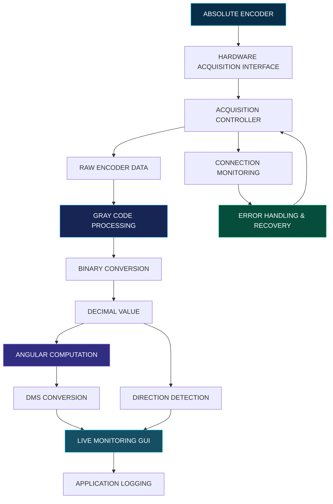

 <div align="center">


<br/>

**A Python-powered desktop application for real-time absolute encoder data acquisition, angular computation, and continuous monitoring in a scientific observatory environment.**

<br/>


<br/><br/>


<sub>Precision in measurement. Intelligence in processing. Reliability in operation.</sub>

</div>

---

## ◈ 01 — Project Vision

**17-Bit Absolute Encoder Data Acquisition System** is a Python-based desktop application developed during an internship at the **Indian Institute of Astrophysics (IIA), Vainu Bappu Observatory (VBO), Kavalur**.

The application was designed to acquire, process, convert, and monitor encoder data in a real-world scientific environment.

It bridges the gap between physical instrumentation and software by transforming raw encoder signals into meaningful angular measurements through a continuous acquisition and processing workflow.

The project focuses on:

- Real-time data acquisition.
- Accurate encoder data processing.
- Angular measurement conversion.
- Direction detection.
- Continuous application monitoring.
- Reliable hardware–software interaction.

> Not just collecting data. Turning physical measurements into meaningful information.

## ◈ 02 — The Intelligence Behind the System

<div align="center">

|  |  |
|---|---|
| Continuous acquisition of encoder readings. | Conversion of Gray Code into binary representation. |

|  |  |
|---|---|
| Calculation of decimal angle and DMS values. | Identification of clockwise, counter-clockwise and stationary movement. |

|  |  |
|---|---|
| Continuous visualization of processed readings. | Connection monitoring and recovery support. |

</div>

## ◈ 03 — Inside the Data Processing Pipeline

<div align="center">


</div>

### The processing stages

**01 — Acquisition**

Collect encoder data through the connected acquisition interface.

**02 — Signal Processing**

Interpret the acquired digital signal.

**03 — Gray Code Conversion**

Transform the Gray Code representation into its corresponding binary value.

**04 — Decimal Conversion**

Convert the processed binary value into its decimal representation.

**05 — Angular Computation**

Calculate the angular position represented by the encoder reading.

**06 — DMS Representation**

Express the calculated angle in Degrees, Minutes and Seconds.

**07 — Direction Analysis**

Compare successive readings to determine movement direction.

**08 — Live Visualization**

Display the latest processed readings through the desktop application.

## ◈ 04 — System Architecture

<div align="center">


</div>



## ◈ 05 — Technology Arsenal

<div align="center">

| Layer | Technology |
|---|---|
| Programming Language | Python |
| Desktop Interface | wxPython |
| Operating Environment | Windows |
| Data Acquisition | Digital hardware interface |
| Data Processing | Gray Code and Binary Conversion |
| Angular Measurement | Decimal Degrees and DMS |
| Configuration | INI-based configuration |
| Application Monitoring | Python Logging |
| Integration | Hardware–Software Interface |

<br/>


</div>

## ◈ 06 — Application Experience

The desktop application provides a dedicated interface for observing encoder readings and monitoring the acquisition process.

Key interface capabilities include:

- Live encoder readings.
- Angular position display.
- Degree-Minute-Second representation.
- Movement direction indication.
- Hardware connection status.
- Application date and time.
- Continuous acquisition monitoring.

<div align="center">


<sub>Figure 01 — Live Encoder Data Acquisition Dashboard</sub>

<br/><br/>


<sub>Figure 02 — Application Startup and Hardware Initialization</sub>

<br/><br/>


<sub>Figure 03 — Continuous Real-Time Encoder Monitoring</sub>

</div>

## ◈ 07 — Engineering for Reliability

A real-world hardware application must do more than produce readings. It must also handle interruptions and maintain predictable operation.

Verifiably implemented application capabilities include:

| Capability | Purpose |
|---|---|
| Hardware Detection | Identify hardware availability during initialization. |
| Connection Monitoring | Observe the acquisition connection status. |
| Automatic Reconnection | Recover from supported temporary interruptions. |
| Logging | Record application events and troubleshooting information. |
| Configuration | Maintain application settings separately. |
| Graceful Shutdown | Close application resources cleanly. |
| Direction Handling | Account for movement across the angular boundary. |

## ◈ 08 — Testing & Validation

The developed application was tested in the actual observatory hardware environment.

The testing process covered:

- Application startup and initialization.
- Hardware recognition.
- Data acquisition.
- Gray Code processing and conversion.
- Angle and DMS calculations.
- Direction identification.
- Stationary encoder behaviour.
- Continuous monitoring.
- Connection handling.
- GUI operation and stability.

A particularly rewarding part of the project was observing the application communicate successfully with the physical hardware and display processed readings in real time.

## ◈ 09 — Project Gallery

<div align="center">


<sub>Figure 04 — Scientific Environment at Vainu Bappu Observatory</sub>

<br/><br/>


<sub>Figure 05 — Project Testing Environment</sub>

<br/><br/>


<sub>Figure 06 — Application Output</sub>

</div>

## ◈ 10 — Running the Application

### Prerequisites

- Windows 10 or Windows 11.
- Python installed and configured.
- Required Python dependencies.
- wxPython.
- Compatible acquisition hardware and its authorised runtime environment.

### 01 — Clone the repository

```bash
git clone https://github.com/<YOUR_USERNAME>/<YOUR_REPOSITORY>.git
cd <YOUR_REPOSITORY>
```

### 02 — Create a virtual environment

```bash
python -m venv venv
```

### 03 — Activate the environment

**Windows**

```bash
venv\Scripts\activate
```

### 04 — Install the dependencies

```bash
pip install -r requirements.txt
```

### 05 — Launch the application

```bash
python encoder_daq_single.py
```

> **Note:** Full data acquisition functionality requires the compatible hardware environment. The application should be operated only with the authorised runtime and configuration.

## ◈ 11 — Learning Outcomes

This project provided practical experience in several engineering areas:

- Python application development.
- Desktop GUI engineering.
- Hardware–software integration.
- Real-time data acquisition.
- Digital data representation.
- Gray Code and binary conversion.
- Angular measurement systems.
- Direction detection algorithms.
- Connection management and recovery.
- Logging and debugging.
- Testing applications with physical hardware.

It also provided valuable exposure to the challenges of developing software for a scientific research environment.

## ◈ 12 — Project Information

<div align="center">

| Detail | Information |
|---|---|
| Project | 17-Bit Absolute Encoder Data Acquisition System |
| Organization | Indian Institute of Astrophysics |
| Location | Vainu Bappu Observatory, Kavalur |
| Application | Desktop Data Acquisition System |
| Language | Python |
| GUI Framework | wxPython |
| Domain | Scientific Instrumentation |
| Focus | Real-Time Data Processing and Monitoring |

</div>

## ◈ 13 — Future Scope

- Enhanced hardware diagnostics.
- Improved acquisition monitoring.
- Extended data visualization.
- Additional export and reporting capabilities.
- Further improvements to configuration management.
- Expanded system validation and testing.

## ◈ 14 — Confidentiality Notice

This repository presents the project at an academic and software-development level.

Certain internal hardware specifications, communication configurations, driver implementation details, and other organization-specific information have intentionally been omitted to respect institutional confidentiality.

The README is not intended to document or disclose proprietary observatory infrastructure.

## ◈ 15 — Acknowledgement

I sincerely thank the **Indian Institute of Astrophysics (IIA), Vainu Bappu Observatory, Kavalur**, for providing the opportunity to work on a practical scientific software development project.

My heartfelt gratitude to **Mrs. Vellai Selvi (Engineer D)** for her guidance, encouragement, and support throughout the internship.

---

<div align="center">


<br/><br/>

**ENGINEERING × SCIENCE × SOFTWARE**

<sub>17-Bit Absolute Encoder Data Acquisition System</sub>

<br/>


</div>
