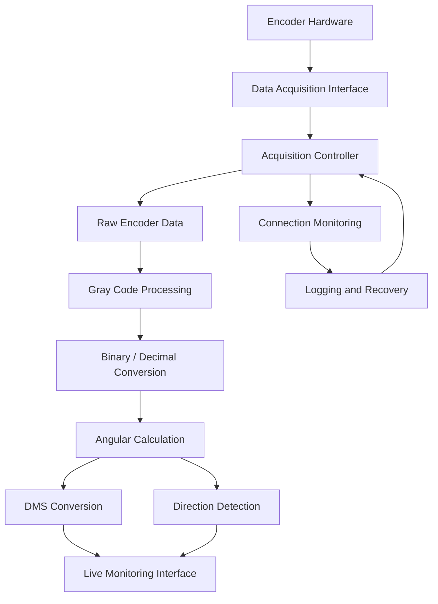

# 🌌 17-Bit Absolute Encoder Data Acquisition System

<p align="center">
  <strong>A Real-Time Python Desktop Application for Scientific Data Acquisition</strong>
  <br/>
  Developed during an internship at the Indian Institute of Astrophysics (IIA), Vainu Bappu Observatory, Kavalur.
</p>

<p align="center">
  
  
  
  
</p>

---

## 🔭 Overview

The **17-Bit Absolute Encoder Data Acquisition System** is a Python-based desktop application developed to acquire, process, and monitor encoder data in a scientific observatory environment.

The application establishes communication with the data acquisition hardware, processes the incoming encoder signals, converts the acquired values into meaningful angular measurements, and presents the results through a graphical user interface.

The primary objective was to develop a reliable and user-friendly application capable of supporting continuous, real-time encoder monitoring.

This project provided hands-on experience in desktop application development, hardware–software integration, real-time data processing, and industrial automation.

## ✨ Key Features

| Feature | Description |
|---|---|
| ⚡ Real-Time Acquisition | Continuously acquires encoder data from the connected hardware. |
| 🔄 Data Conversion | Processes encoder signals and performs Gray Code to Binary conversion. |
| 📐 Angular Computation | Converts acquired values into decimal angles and Degree-Minute-Second (DMS) representations. |
| 🧭 Direction Detection | Identifies clockwise, counter-clockwise, and stationary movement. |
| 📊 Live Monitoring | Displays updated encoder readings through the desktop interface. |
| 🔌 Hardware Detection | Checks hardware availability and monitors connection status. |
| ♻️ Reconnection Handling | Supports recovery from temporary hardware connection interruptions. |
| 📝 Logging | Maintains application logs for monitoring and troubleshooting. |
| ⚙️ Configuration | Supports configurable application settings. |
| 🖥️ Desktop Interface | Provides a dedicated graphical interface for operating and monitoring the application. |

## 🏗️ System Architecture

The application follows a modular acquisition and processing workflow.



### Data Processing Workflow

1. **Data Acquisition:** Read the encoder signal through the connected acquisition interface.
2. **Signal Processing:** Process the acquired encoder data.
3. **Code Conversion:** Convert Gray Code into its corresponding binary representation.
4. **Value Calculation:** Derive the decimal encoder value and angular position.
5. **Coordinate Representation:** Convert angular measurements into DMS format.
6. **Direction Analysis:** Determine the direction of movement by analysing successive readings.
7. **Live Display:** Present the processed values through the graphical interface.

## 🖥️ Application Preview

The application is designed with an industrial-style desktop interface focused on readability, monitoring, and ease of operation.

<!-- Add your actual application screenshots to the repository's assets folder. -->

<p align="center">
  
  <br/>
  <em>Figure 1 – Encoder Data Acquisition Dashboard</em>
</p>

<p align="center">
  
  <br/>
  <em>Figure 2 – Application Startup and Hardware Initialization</em>
</p>

<p align="center">
  
  <br/>
  <em>Figure 3 – Continuous Real-Time Encoder Monitoring</em>
</p>

## 🛠️ Technology Stack

| Component | Technology |
|---|---|
| Programming Language | Python |
| Desktop GUI | wxPython |
| Operating System | Windows |
| Hardware Communication | Digital I/O acquisition interface |
| Data Processing | Gray Code and binary conversion |
| Angular Representation | Decimal Degrees and DMS |
| Application Integration | Native hardware interface integration |
| Configuration | INI-based configuration |
| Logging | Python logging |

## ⚙️ Getting Started

### Prerequisites

Before running the application, ensure that you have:

- A Windows 10/11 environment.
- Python installed and configured.
- wxPython and the project's required Python dependencies.
- The compatible data acquisition hardware and its authorised runtime environment.
- Access to the required hardware connection.

### Installation

**1. Clone the repository**

```bash
git clone <YOUR_REPOSITORY_URL>
```

**2. Navigate to the project directory**

```bash
cd <YOUR_REPOSITORY_DIRECTORY>
```

**3. Install dependencies**

If a `requirements.txt` file is included:

```bash
pip install -r requirements.txt
```

Otherwise, install the dependencies specified by the project.

**4. Run the application**

```bash
python encoder_daq_single.py
```

> **Note:** Successful hardware acquisition requires the compatible hardware interface and its authorised runtime environment. Running the application without the required hardware may limit acquisition functionality.

## 🧪 Testing and Validation

The application was tested using the actual observatory hardware environment.

Validation activities included:

- Application startup and initialization.
- Hardware detection and connection checks.
- Encoder data acquisition.
- Data conversion and angular calculations.
- Direction detection.
- Continuous monitoring.
- Connection interruption and recovery behaviour.
- GUI functionality and application stability.

The testing process provided practical experience in identifying and resolving issues that arise when software interacts with physical hardware.

## 🎓 Learning Outcomes

This project strengthened practical understanding of:

- Python desktop application development.
- Hardware–software integration.
- Real-time data acquisition.
- Digital signal processing fundamentals.
- Gray Code and binary representations.
- Angular measurement systems.
- Graphical user interface development.
- Hardware connection management.
- Error handling and application reliability.
- Debugging and testing with physical equipment.

## 📌 Project Information

| Detail | Information |
|---|---|
| Project | 17-Bit Absolute Encoder Data Acquisition System |
| Organization | Indian Institute of Astrophysics |
| Location | Vainu Bappu Observatory, Kavalur |
| Application Type | Desktop Application |
| Primary Language | Python |
| Application Domain | Scientific Data Acquisition and Industrial Automation |

## 🔒 Confidentiality Notice

This repository documents the software development aspects of an academic internship project.

Certain hardware-specific configurations, internal communication details, and implementation information have intentionally been kept general to respect organizational confidentiality.

## 🙏 Acknowledgement

I sincerely thank the Indian Institute of Astrophysics and everyone who supported and guided me throughout this internship.

Special thanks to **Mrs. Vellai Selvi (Engineer D)** for her guidance, encouragement, and support during the development of this project.

---

<p align="center">
  <strong>Built with Python. Driven by curiosity. Inspired by science. 🌌</strong>
  <br/>
  <sub>17-Bit Absolute Encoder Data Acquisition System</sub>
</p>
